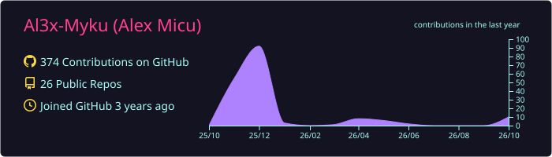
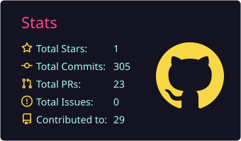
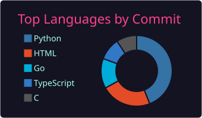

# 👋 Hi, I'm Micu (@Al3x-Myku)

Computer Science student at **University POLITEHNICA of Bucharest** (Automatic Control & Computer Science) and independent **IT / cybersecurity consultant**.

- 🔐 Information security audits against **ISO/IEC 27001 / 27002** and **ISO 19011**
- 🛠️ Infrastructure, DevOps and self-hosting — I run my own VPS ([alexmicu.site](https://alexmicu.site)) with Gitea, CI runners and monitoring behind Cloudflare, and I'm building a mini-PC homelab private cloud
- 🌐 Administering UPB web platforms (scientificbulletin.upb.ro, editura.upb.ro)
- 🎓 CCNA instructor at **Hackademy**
- 🏅 InfoEducație olympiad jury member
- 🌱 Currently diving into offensive security and Active Directory attack paths

💞️ Always open to collaborating on security, infrastructure or embedded projects — feel free to reach out!

  

  
  

---

## 📌 Projects

| Project | What it is | Stack |
|---|---|---|
| [**FlyDB**](https://github.com/Al3x-Myku/FlyDB) | Document-oriented NoSQL database with an LSM-tree, memtable-on-TOON storage, gzip compression and an interactive query shell — zero core dependencies | Go |
| [**PhishGuard**](https://github.com/Al3x-Myku/AntigelCluj) | Red/Blue team platform: multi-channel phishing simulation plus ML login-anomaly detection, attacker banning and account lockdown in real time — Cluj Hackathon 2026 | Python · ML · Docker |
| [**DarkMesh**](https://github.com/Al3x-Myku/DarkMesh) | Vulnerable-network simulator for red team training — orchestrates VMs and containers from XML scenarios to practice lateral movement and privilege escalation | Python · Docker |
| [**SolTax RO**](https://github.com/Al3x-Myku/SolanaTaxHelp) | Solana transaction reporting with historical RON valuations, exporting CSVs for ANAF Declarația Unică (D212) | TypeScript · Next.js |
| [**Xandeum pNode Explorer**](https://github.com/Al3x-Myku/Bounty-Xandeum-pNodes) | Real-time analytics dashboard for the Xandeum storage network, with a global node map and per-node metrics — Superteam Earn bounty | TypeScript · Next.js |
| [**QKD Explorer**](https://github.com/Al3x-Myku/Quantum) | Interactive quantum key distribution simulator: Bloch sphere, BB84 with and without an eavesdropper, E91 and a CHSH Bell test | Web |

Also: a [C-to-ASM compiler](https://github.com/Al3x-Myku/Compilator_C-ASM) and a [passkey + gasless Solana starter kit](https://github.com/Al3x-Myku/bountyPasskey).

---

## 🧰 Technologies

### Languages

### Databases

### Frameworks & Libraries

### Infrastructure & DevOps

### Security & Networking

### Embedded

### Tools

---

## 📫 Contact

  
  
  

  

